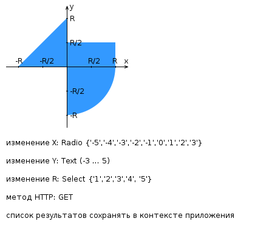

# Лабораторная работа №3

Вариант: **34313**.

## Задание

Разработать веб-приложение на базе сервлетов и JSP, определяющее попадание точки на координатной плоскости в заданную область.

Приложение должно быть реализовано в соответствии с шаблоном MVC и состоять из следующих элементов:

- **ControllerServlet** определяет тип запроса и, в зависимости от того, содержит ли запрос информацию о координатах точки и радиусе, делегирует его обработку одному из перечисленных ниже компонентов. Все запросы внутри приложения должны передаваться этому сервлету по методу `GET` (в соответствии с вариантом задания). Остальные сервлеты с веб-страниц напрямую вызываться не должны.
- **AreaCheckServlet** проверяет попадание точки в область на координатной плоскости и формирует HTML-страницу с результатами проверки. Должен обрабатывать все запросы, содержащие сведения о координатах точки и радиусе области.
- **Страница JSP** формирует HTML-страницу с веб-формой. Должна обрабатывать все запросы, не содержащие сведений о координатах точки и радиусе области.

## Требования к странице JSP

- «Шапка» с ФИО студента, номером группы и номером варианта.
- Форма, отправляющая данные на сервер.
- Поля для задания координат точки и радиуса области в соответствии с вариантом:
  - `X` — `radio`, значения `{-5, -4, -3, -2, -1, 0, 1, 2, 3}`;
  - `Y` — текстовое поле, диапазон `(-3 ... 5)`;
  - `R` — `select`, значения `{1, 2, 3, 4, 5}`.
- JavaScript-сценарий для валидации значений, вводимых в поля формы.
- Интерактивное изображение области на координатной плоскости. Если радиус задан, нажатие на изображение должно обрабатываться JavaScript-функцией, которая определяет координаты точки и отправляет их на сервер для проверки. Если радиус не задан, после нажатия должно выводиться сообщение о невозможности определения координат. После проверки изображение должно обновляться с учётом результатов.
- Таблица предыдущих проверок. Список результатов должен браться из контекста приложения.

## Требования к странице AreaCheckServlet

- Таблица с полученными параметрами.
- Результат вычислений: факт попадания или непопадания точки в область.
- Ссылка на страницу с веб-формой для формирования нового запроса.

## Развёртывание

Развернуть веб-приложение на сервере WildFly. Сервер должен быть запущен в standalone-конфигурации. Порты должны быть настроены в соответствии с выданным `portbase`; доступ к HTTP listener должен быть открыт для всех IP.

## Схема варианта

## Вопросы к защите

1. Java-сервлеты. Особенности реализации, ключевые методы, преимущества и недостатки относительно CGI и FastCGI.
2. Контейнеры сервлетов. Жизненный цикл сервлета.
3. Диспетчеризация запросов в сервлетах. Фильтры сервлетов.
4. HTTP-сессии: назначение, взаимодействие сервлетов с сессией, способы передачи идентификатора сессии.
5. Контекст сервлета: назначение, способы взаимодействия сервлетов с контекстом.
6. JavaServer Pages. Особенности, преимущества и недостатки по сравнению с сервлетами, область применения.
7. Жизненный цикл JSP.
8. Структура JSP-страницы. Комментарии, директивы, объявления, скриптлеты и выражения.
9. Правила записи Java-кода внутри JSP. Стандартные переменные, доступные в скриптлетах и выражениях.
10. Bean-компоненты и их использование в JSP.
11. Стандартные теги JSP. Использование Expression Language (EL) в JSP.
12. Параметры конфигурации JSP в дескрипторе развёртывания веб-приложения.
13. Шаблоны проектирования и архитектурные шаблоны. Использование в веб-приложениях.
14. Архитектура веб-приложений. Шаблон MVC. Архитектурные модели Model 1 и Model 2 и их реализация на платформе Java EE.
